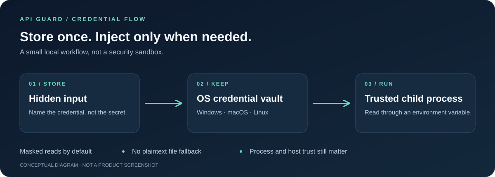

<div align="center">

# API Guard

**Store API credentials in the OS vault and inject them when needed.**

A lightweight credential CLI with masked reads and environment-variable injection for subprocesses.

**English** · [简体中文](README.md)

[](api-guardian/scripts/api_guard.py)

[Quick start](#快速开始) · [Example](#一次使用是什么样) · [Commands](#命令速查) · [Security boundaries](#安全边界) · [Agent skill](api-guardian/SKILL.md)

</div>



API Guard stores a credential under a logical name and retrieves it when a command needs it. This reduces manual copying and writing keys into source code, notes, or `.env` files. **It does not sandbox subprocesses or guarantee that a key cannot leak.**

> [!IMPORTANT]
> **There is no plaintext-file fallback.** Check that the OS credential backend works before storing a key, and read the [security boundaries](#安全边界) before use.

<a id="快速开始"></a>
## Quick start

You need Python 3.10+ and a working OS credential store:

| Platform | Backend | Prerequisite |
| --- | --- | --- |
| Windows | Credential Manager | Calls `advapi32` through standard-library `ctypes` |
| macOS | Keychain | Uses the system `/usr/bin/security` command |
| Linux | Secret Service | Requires `secret-tool` and an available desktop keyring session |

On Ubuntu / Debian, install a missing command with `sudo apt install libsecret-tools`. Installing it does not start or unlock Secret Service. An unavailable backend produces an error; the tool does not fall back to a plaintext file.

```bash
git clone https://github.com/yuzhang-zhong/API-Guard.git
cd API-Guard/api-guardian

# 隐藏输入并确认密钥
python scripts/api_guard.py store openai

# 默认只显示掩码
python scripts/api_guard.py get openai

# 只检查变量是否存在，不输出密钥，也不调用付费 API
python scripts/api_guard.py run openai OPENAI_API_KEY -- python -c "import os; print(bool(os.getenv('OPENAI_API_KEY')))"
```

The final command should print `True` after a successful read. To run your own program, replace that final Python check with a command such as `python app.py` or `npm test`. Use a working directory that matches the program's relative paths.

<a id="一次使用是什么样"></a>
## Example

This is a **synthetic example, not a real key or a runtime screenshot**. Assume the stored test value is `demo-placeholder-1234`:

```text
$ python scripts/api_guard.py get openai
openai: dem...1234 (21 chars)
```

For long values, the default mask retains the first three characters, last four characters, and length. Values of eight characters or fewer are replaced entirely with asterisks. Masked output can still disclose information: do not publish screenshots of real credentials casually.

<a id="命令速查"></a>
## Commands

Run these commands from `API-Guard/api-guardian`.

| Goal | Command | Note |
| --- | --- | --- |
| Store or replace | `python scripts/api_guard.py store openai` | Hidden input with confirmation by default |
| Read a masked value | `python scripts/api_guard.py get openai` | Does not print the complete value |
| Inject and run | `python scripts/api_guard.py run openai OPENAI_API_KEY -- python app.py` | Passes the variable to the new subprocess |
| List names | `python scripts/api_guard.py list` | Enumeration is currently implemented only on Windows |
| Delete a local credential | `python scripts/api_guard.py delete openai` | Does not revoke the provider-side key |
| Read help | `python scripts/api_guard.py --help` | Subcommands also accept `--help` |

<a id="从已有输入导入"></a>
### Import an existing value

```bash
# 从已经存在的环境变量导入
python scripts/api_guard.py store openai --from-env OPENAI_API_KEY

# 从 stdin 导入（POSIX shell 示例）
printf "%s" "$OPENAI_API_KEY" | python scripts/api_guard.py store openai --stdin
```

Choose only one of `--stdin`, `--from-env`, and `--value`. Empty values are rejected, and a missing environment variable produces an error.

<details>
<summary>Read the risks before revealing or passing a plaintext value</summary>

```bash
python scripts/api_guard.py get openai --reveal
python scripts/api_guard.py store openai --value "<API_KEY>"
```

`--reveal` writes the complete value to standard output. `--value` may leave a key in shell history or process arguments. Prefer hidden input, stdin, or an existing environment variable. Do not paste real keys into chat, code, logs, or screenshots.

</details>

<a id="轮换凭据"></a>
### Rotate a credential

There is no separate `rotate` command. Generate a new key at the provider, replace the stored credential with `store openai`, verify it through `run`, then revoke the old key. **Replacing or deleting a local value does not revoke a provider-side credential.**

Names must contain 1–80 characters and use only letters, digits, `.`, `_`, `:`, or `-`. Prefer logical names such as `openai`, `github`, `stripe-prod`, `stripe-test`, or `anthropic-dev`. Do not put secrets in names.

<a id="安全边界"></a>
## Security boundaries

- Storage protection depends on the operating system. This is not a team secrets service and provides no approval, remote distribution, or audit platform.
- Run only commands you trust. Subprocesses and their descendants can read injected environment variables, and may print, log, or transmit them. Other inherited environment variables are not automatically cleared.
- The macOS implementation has a specific limitation: it passes values through `security add-generic-password -w`, so internal subprocess arguments briefly contain the secret. Hidden input does not remove that risk.
- No plaintext fallback does not mean protection against a compromised account, host, or process. Use provider-side least privilege and regular rotation.
- An empty `list` does not prove that no keys exist. macOS / Linux currently lack enumeration, but known names can still be read or deleted.
- Rotate a leaked credential first, then clean files, logs, and Git history. Deleting a local file is insufficient.

<a id="git-安全检查"></a>
## Git safety checks

[`.gitignore`](.gitignore) excludes common sensitive file patterns, including `.env`, `.env.*`, `*.pem`, `*.key`, `*.p12`, `*.pfx`, `*secret*`, `*token*`, `*.sqlite`, and `*.db`. Ignore rules do not remove tracked files and are not a secrets scanner.

```bash
git status --short
git diff
git diff --cached
git ls-files --others --exclude-standard
```

<a id="实现与-agent-接入"></a>
## Implementation and agent integration

- [`api_guard.py`](api-guardian/scripts/api_guard.py): storage backends, input validation, masking, and subprocess injection.
- [`SKILL.md`](api-guardian/SKILL.md): agent workflow and secret-handling rules.
- [`openai.yaml`](api-guardian/agents/openai.yaml): agent configuration entry, described as “Securely store and use API credentials”.

The implementation uses only the Python standard library, including `argparse`, `ctypes`, `getpass`, and `subprocess`; there are no pip dependencies. Keep the complete `api-guardian/` directory when integrating it, and follow the host agent's credential-authorization and security rules.
