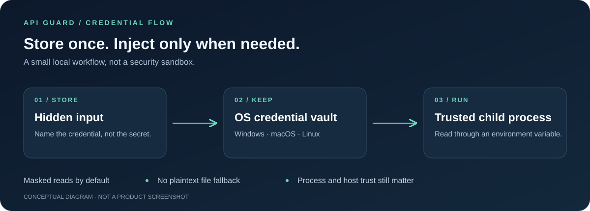

<div align="center">

# API Guard

**把密钥留在系统钥匙串，把能力交给你的程序。**

轻量级 API 凭据 CLI：保存到操作系统密钥库，默认脱敏读取，按需注入子进程环境。

[](api-guardian/scripts/api_guard.py)
[](#实现与-agent-接入)
[](#快速开始)

[快速开始](#快速开始) · [使用示例](#一次使用是什么样) · [命令速查](#命令速查) · [安全边界](#安全边界) · [Agent skill](api-guardian/SKILL.md)

</div>



API Key 不该散落在源代码、笔记和 `.env` 文件里。API Guard 用一个逻辑名称保存凭据，再让需要它的命令临时读取。它减少手工复制与文件落盘，**不把子进程变成安全沙箱，也不保证密钥永不泄露**。

| 保存 | 查看 | 使用 |
| --- | --- | --- |
| 隐藏输入，交给系统密钥库 | 默认只读脱敏结果 | 按需注入受信任的子进程 |

> [!IMPORTANT]
> **没有明文文件 fallback。** 先确认密钥库后端可用，再保存凭据；使用前请阅读[安全边界](#安全边界)。

## 快速开始

先确认本机有 Python 3.10+，以及可用的系统密钥库：

| 系统 | 存储后端 | 前置条件 |
| --- | --- | --- |
| Windows | Credential Manager | 经标准库 `ctypes` 调用 `advapi32` |
| macOS | Keychain | 使用系统 `/usr/bin/security` |
| Linux | Secret Service | `secret-tool` 和可用的桌面密钥库会话 |

Ubuntu / Debian 如缺少命令，可安装 `libsecret-tools`：`sudo apt install libsecret-tools`。安装命令本身不等于已启动或解锁 Secret Service；无可用后端时工具会报错，不回退到明文文件。

```bash
git clone https://github.com/yuzhang-zhong/API-Guard.git
cd API-Guard/api-guardian

# 隐藏输入并确认密钥
python scripts/api_guard.py store openai

# 默认只显示掩码
python scripts/api_guard.py get openai

# 只检查变量是否存在，不输出密钥，也不调用付费 API
python scripts/api_guard.py run openai OPENAI_API_KEY -- python -c "import os; print(bool(os.getenv('OPENAI_API_KEY')))"
```

最后一条命令读取成功时应输出 `True`。运行自己的程序时，把最后的 Python 检查命令替换为 `python app.py` 或 `npm test`；确保工作目录与程序的相对路径匹配。

## 一次使用是什么样

下面是**合成示例，不是真实密钥，也不是实机截图**。假设存入的测试值为 `demo-placeholder-1234`：

```text
$ python scripts/api_guard.py get openai
openai: dem...1234 (21 chars)
```

默认掩码保留长密钥的前三位、后四位和长度；八个字符及以下全部显示为星号。因此，脱敏输出也可能包含不该公开的部分信息，请勿随意发布真实凭据截图。

## 命令速查

以下命令均在 `API-Guard/api-guardian` 中运行。

| 目的 | 命令 | 注意 |
| --- | --- | --- |
| 保存或覆盖 | `python scripts/api_guard.py store openai` | 默认隐藏输入两次 |
| 脱敏读取 | `python scripts/api_guard.py get openai` | 不显示完整值 |
| 注入并运行 | `python scripts/api_guard.py run openai OPENAI_API_KEY -- python app.py` | 仅向新子进程传递环境变量 |
| 枚举名称 | `python scripts/api_guard.py list` | 当前仅 Windows 后端实现枚举 |
| 删除本地凭据 | `python scripts/api_guard.py delete openai` | 不会撤销服务商侧的 Key |
| 查看帮助 | `python scripts/api_guard.py --help` | 子命令也支持 `--help` |

### 从已有输入导入

```bash
# 从已经存在的环境变量导入
python scripts/api_guard.py store openai --from-env OPENAI_API_KEY

# 从 stdin 导入（POSIX shell 示例）
printf "%s" "$OPENAI_API_KEY" | python scripts/api_guard.py store openai --stdin
```

`--stdin`、`--from-env` 与 `--value` 只能选择一个。工具拒绝空值；缺少环境变量时会报错。

<details>
<summary>需要明文或直接传值时，请先了解风险</summary>

```bash
python scripts/api_guard.py get openai --reveal
python scripts/api_guard.py store openai --value "<API_KEY>"
```

`--reveal` 会把完整值写到终端标准输出；`--value` 可能把密钥留在 shell history 或进程参数中。优先使用隐藏输入、stdin 或已有环境变量。不要把真实密钥粘贴到聊天、代码、日志或截图里。

</details>

### 轮换凭据

没有单独的 `rotate` 命令。先在服务商后台生成新 Key，用 `store openai` 覆盖同名凭据，再通过 `run` 验证，最后撤销旧 Key。**本地覆盖或删除不会替你在服务商处撤销凭据。**

名称必须为 1–80 个字符，只能包含字母、数字、`.`、`_`、`:`、`-`。推荐 `openai`、`github`、`stripe-prod`、`stripe-test`、`anthropic-dev` 等逻辑名称，不要把秘密放进名称。

## 安全边界

- **存储保护依赖操作系统。** 本工具不是团队密钥管理服务，不提供权限审批、远程分发或审计平台。
- **只运行你信任的命令。** 子进程及其后代可读取注入的环境变量；被调用程序仍可能打印、记录或外传密钥。继承的其他环境变量也不会被自动清除。
- **macOS 有实现层面的限制。** 当前 Keychain 后端通过 `security add-generic-password -w` 传值，内部子进程参数会短暂包含秘密；隐藏输入并不能消除这层风险。
- **没有明文 fallback。** 但这不等于保护已被入侵的账户、主机或进程，也不替代服务商端权限最小化与定期轮换。
- **`list` 为空不代表密钥不存在。** macOS / Linux 后端当前没有实现枚举，仍可按已知名称读取或删除。
- **发现泄露先轮换。** 然后清理文件、日志与 Git 历史；只删除本地文件不够。

## Git 安全检查

[`.gitignore`](.gitignore) 忽略了 `.env`、`.env.*`、`*.pem`、`*.key`、`*.p12`、`*.pfx`、`*secret*`、`*token*`、`*.sqlite`、`*.db` 等常见敏感文件。忽略规则不会移除已跟踪文件，也不是秘密扫描器。

```bash
git status --short
git diff
git diff --cached
git ls-files --others --exclude-standard
```

## 实现与 Agent 接入

| 文件 | 用途 |
| --- | --- |
| [`api_guard.py`](api-guardian/scripts/api_guard.py) | 存储后端、输入校验、掩码和子进程注入 |
| [`SKILL.md`](api-guardian/SKILL.md) | Agent 使用流程与秘密处理规则 |
| [`openai.yaml`](api-guardian/agents/openai.yaml) | Agent 配置入口，说明为 “Securely store and use API credentials” |

实现只使用 Python 标准库（`argparse`、`ctypes`、`getpass`、`subprocess` 等），不需要 pip 依赖。集成时保留整个 `api-guardian/` 目录，并遵守宿主 Agent 的凭据授权与安全规则。
